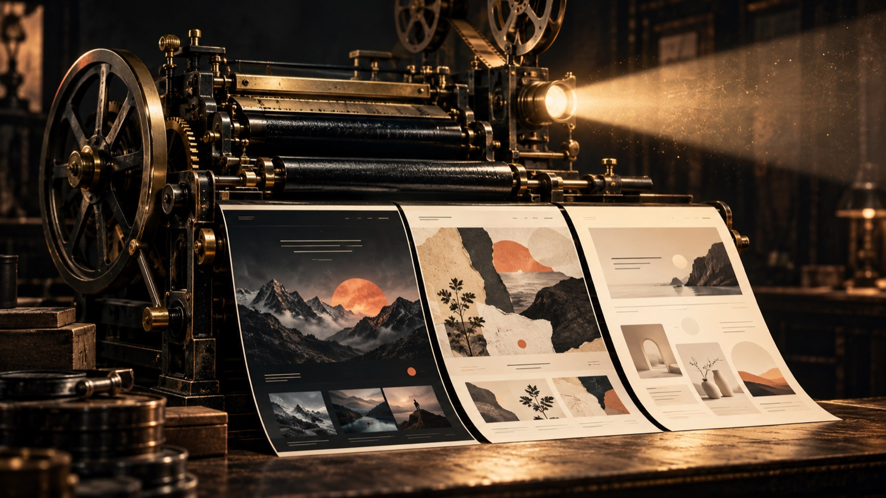

<p align="center">
  
</p>

<h1 align="center">landing-machine</h1>

<p align="center">
  <b>제품 하나를 넣으면 랜딩페이지 세 벌이 나온다.</b><br>
  레퍼런스를 뜯어보고 얻은 원칙, 수치, 체크리스트를 모은 랜딩페이지 제작 방법론
</p>

<p align="center">
  <a href="#세-벌을-만드는-방법">버전</a> ·
  <a href="#작업-흐름">작업 흐름</a> ·
  <a href="#여덟-가지-원칙">원칙</a> ·
  <a href="#시작하기">시작하기</a> ·
  <a href="#문서-지도">문서 지도</a>
</p>

---

## 랜딩 하나로 정하지 않는다

같은 제품, 같은 사실로 **성격이 다른 2~3개 버전**을 만들어 나란히 놓고 고른다. 버전끼리 다른 건 표현이다. 사실은 [콘텐츠 파일](templates/content.md) 하나에서 읽어 오기 때문에 버전을 하나 더 만드는 비용은 레이아웃 값뿐이다.

```
content.md (사실 · 주장 · 증거 · 카피)
   ├── Film 레이아웃    → scenes[]
   ├── Hybrid 레이아웃  → hero scenes[] + sections[]
   └── Clear 레이아웃   → sections[]
```

## 세 벌을 만드는 방법

버전 = **골격 × 룩**. 골격은 페이지 구조, 룩은 겉모습이다. 같은 골격에 룩만 바꿔도 다른 페이지가 된다.

### 골격 3종

| | **Film** | **Hybrid** | **Clear** |
|---|---|---|---|
| 구조 | 스크롤로 넘기는 필름 한 편 → 제품 투어 → 포스터 CTA | 히어로만 짧은 필름(3~4비트), 아래는 섹션 | 히어로 → 데모 → 신뢰 → 기능 → 가격 → FAQ → CTA |
| 주인공 | 그림으로 만든 세계와 카메라 | 첫 화면의 몰입, 그다음은 정보 | 스크립트로 움직이는 HTML 제품 데모 |
| 난이도 | 높음 | 중간 | 낮음~중간 |
| 맞는 곳 | 브랜드 런칭, 이야기가 핵심인 제품 | 인상과 전환을 둘 다 잡을 때 | B2B, 비교하는 방문자, 빠른 출시 |

### 룩 7종

| 룩 | 만드는 방식 | 생성 비용 | 골격 |
|---|---|---|---|
| 페인터리 필름 | 손그림이나 AI 4K 그림 위로 카메라 이동, 셰이더 전환 | 높음 | Film, Hybrid |
| AI 디오라마 플라이스루 | AI 영상 클립을 이어 붙여 스크롤로 재생 | 클립당 약 23크레딧 | Film, Hybrid |
| 페이퍼 콜라주 스톱모션 | AI로 만든 컷아웃 요소를 화면에서 조립 | 요소당 약 3크레딧 | 전부 |
| 코드 드로잉 | 캔버스·WebGL로 직접 그리는 스타일 51종 | 0 | Film, Hybrid |
| 웜 미니멀 | 스크린샷 카드와 코드로 만든 제품 데모 | 0 | Clear |
| 메타포 다이어그램 | 검정 바탕, 큰 글씨, 선이 그려지는 SVG 모션 | 0 | Hybrid, Film |
| 클리어 + 시네마틱 장면 1개 | 깔끔한 섹션에 three.js 장면 하나만 | 0 | Clear |

처음 내는 세 벌은 보통 이렇게 고른다.

- **A.** Clear × 웜 미니멀: 기본안, 가장 빠르다
- **B.** Hybrid × 페이퍼 콜라주: 히어로에서 요소가 조립되고 아래는 Clear
- **C.** Film × 코드 드로잉 또는 AI 디오라마: 브랜드를 보여 주는 안

자세한 비교와 고르는 기준은 [docs/07-versions.md](docs/07-versions.md)에 있다.

## 작업 흐름

단계마다 게이트가 있고, 통과하지 못하면 다음 단계로 넘어가지 않는다. 랜딩이 무너지는 원인은 대부분 순서다. 에셋을 다 만든 뒤에 이야기를 바꾸는 식이다.

```
0 브리프 → 0.5 콘텐츠 모델 → 0.7 버전 제시 → 선택
  → 1 내러티브 → 2 아트 디렉션 → 3 기술 티어 → 4 프리비즈
  → 5 에셋 → 6 구현 → 7 품질 게이트 → 8 출시
```

| 단계 | 게이트 |
|---|---|
| 0 브리프 | 한 문장 피치, CTA 하나, 증거 자산이 문장으로 적혀 있다 |
| 0.5 콘텐츠 모델 | 모든 주장에 증거가 붙어 있다 |
| 0.7 버전 제시 | 만들 버전을 골랐고 이유가 브리프에 있다 |
| 1 내러티브 | 비트 표만 읽어도 이야기가 이해된다. 헤드라인은 한 줄 14자 안쪽 |
| 2 아트 디렉션 | 키 비주얼 1장, 타이포 시안 1장 |
| 4 프리비즈 | 회색 박스 목업을 끝까지 스크롤해도 지루하거나 급한 구간이 없다 |
| 5 에셋 | 장면 스틸을 한 화면에 늘어놓으면 한 세계로 읽힌다 |
| 7 품질 게이트 | [체크리스트](docs/06-quality-gate.md)를 브라우저에서 직접 확인했다 |

전체 과정은 [docs/01-process.md](docs/01-process.md)에 있다.

## 여덟 가지 원칙

1. **이야기 먼저.** 비트 하나에는 역할 하나. 증거는 이야기 세계 안에서 등장시킨다.
2. **진행값 하나와 장면 배열 하나.** 모든 연출은 `scenes` 데이터에서 읽는다.
3. **스크롤을 빼앗지 않는다.** 네이티브 스크롤 위에 지수 스무딩(τ≈45ms)으로 무게감만 준다.
4. **배경과 오버레이는 같은 카메라를 쓴다.** 비트 대부분은 느린 푸시인 하나로 충분하다.
5. **시그니처 전환은 2~3개.** RIPPLE, APERTURE, GRAIN.
6. **에디토리얼 타이포.** 얇은 한글 세리프, 모노 라벨, 번호 캡션, 헤어라인 그리드.
7. **엔진보다 아트 디렉션의 일관성.** 프롬프트 프리앰블을 똑같이 쓰고, 소스와 모델은 하나만 쓴다.
8. **폴백은 처음부터.** reduced-motion, WebGL 없음, 모바일을 기능과 같은 PR에 넣는다.

## 시작하기

```bash
git clone https://github.com/HSUNEH/landing-machine.git
cd landing-machine

# 1. 브리프와 콘텐츠 모델을 채운다
mkdir -p sites/<제품>
cp templates/brief.md   sites/<제품>/BRIEF.md
cp templates/content.md sites/<제품>/content.md

# 2. 카피를 검사한다 (S1이 0이어야 통과)
python3 tools/copy_lint.py sites/<제품>/content.md

# 3. AI 영상 체인을 쓴다면 이음새를 검사한다 (ffmpeg, Pillow 필요)
brew install ffmpeg pillow
python3 tools/seam_check.py clip.mp4 first.png last.png
```

| 도구 | 하는 일 |
|---|---|
| [tools/copy_lint.py](tools/copy_lint.py) | 한국어 카피에서 AI 티 패턴, 히어로 길이, 어조 혼용을 잡는다 |
| [tools/seam_check.py](tools/seam_check.py) | 영상 클립의 첫·끝 프레임이 입력 스틸에 붙었는지 PSNR로 본다 |
| [tools/publish_pages.py](tools/publish_pages.py) | 시안 페이지만 배포 레포로 복사한다(문서는 빼고) |

Claude Code 같은 에이전트로 작업한다면 [CLAUDE.md](CLAUDE.md)에 작업 규칙이 있다.

## 문서 지도

| 문서 | 내용 |
|---|---|
| [01 프로세스](docs/01-process.md) | 브리프부터 출시까지 단계와 게이트 |
| [02 내러티브](docs/02-narrative.md) | 이야기 구조, 비트 표, 카피 길이 |
| [03 비주얼](docs/03-visual.md) | 스타일 선택, 타이포·컬러 토큰, 에디토리얼 장치, 질감 |
| [04 모션과 기술](docs/04-motion-and-tech.md) | 장면 배열 골격, T0~T3 티어, 카메라, 전환, 이징, 오프닝 |
| [05 에셋](docs/05-assets.md) | 에셋 목록, AI 생성 파이프라인, 인코딩 수치 |
| [06 품질 게이트](docs/06-quality-gate.md) | 출시 전 체크리스트 |
| [07 버전](docs/07-versions.md) | 골격 × 룩, 변주 축, 공통 콘텐츠 모델 |
| [08 카피](docs/08-copy.md) | AI 티 금지 패턴과 쿼터, 자리별 규칙, 표기 |

<details>
<summary><b>템플릿과 레퍼런스 노트</b></summary>

**템플릿**

- [templates/brief.md](templates/brief.md): 새 랜딩을 시작할 때 채우는 브리프와 비트 표
- [templates/content.md](templates/content.md): 모든 버전이 함께 읽는 콘텐츠 모델
- [templates/look.md](templates/look.md): 룩 스펙 양식(재료, 색, 타입, 모션, 카메라 문법, 함정)

**레퍼런스 노트**

- [homeflix-teardown](docs/refs/homeflix-teardown.md): 깔끔한 페이지에 시네마틱 장면 하나
- [sddaddad-teardown](docs/refs/sddaddad-teardown.md): SVG 선 그리기와 `offset-path` 모션
- [pasteup](docs/refs/pasteup.md): 콜라주 룩, 스톱모션 케이던스, DOM 조립
- [lemo-opuscar](docs/refs/lemo-opuscar.md): 결정적 렌더 계약, 스타일 51종
- [scroll-world](docs/refs/scroll-world.md): AI 영상 체인과 이음새 법칙, 스크럽 엔진
- [21st-dev](docs/refs/21st-dev.md): 일반 섹션용 컴포넌트 레지스트리
- [ko-humanizer](docs/refs/ko-humanizer.md): 한국어 AI 티 제거 오픈소스 4종 실측
- [ad-copy](docs/refs/ad-copy.md): 국내외 슬로건과 헤드라인 예시
- [styles-2026](docs/refs/styles-2026.md): 2026 웹 디자인 스타일 13가지와 업종 궁합

</details>

## 아직 정하지 않은 것

- **구현 스택.** 지금 제안은 바닐라 TS 필름 엔진 + Next.js App Router 껍데기 + 21st.dev 부품이다. 첫 제품 브리프를 받고 확정한다.
- **첫 적용 제품과 에셋 소스.** 외주 일러스트로 갈지 AI 생성으로 갈지.

---

<p align="center"><sub>대표 이미지는 AI로 생성했다.</sub></p>
